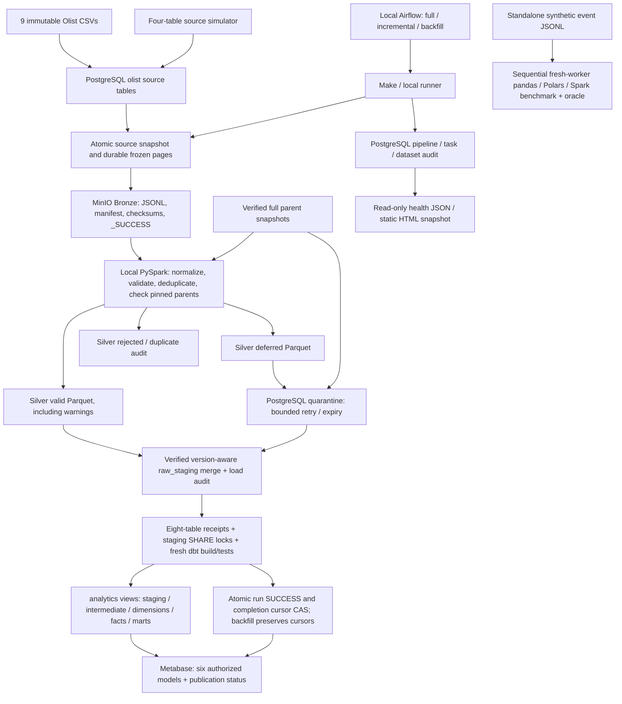
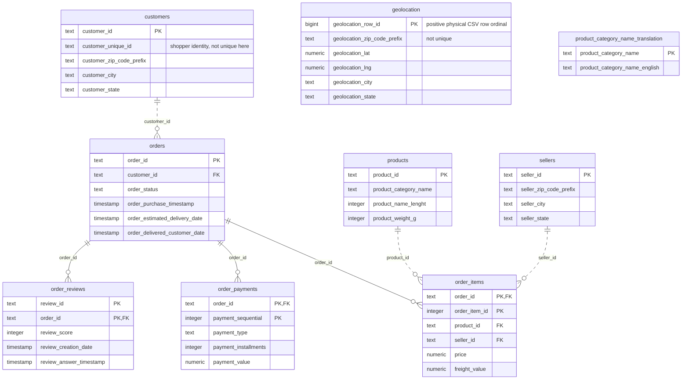
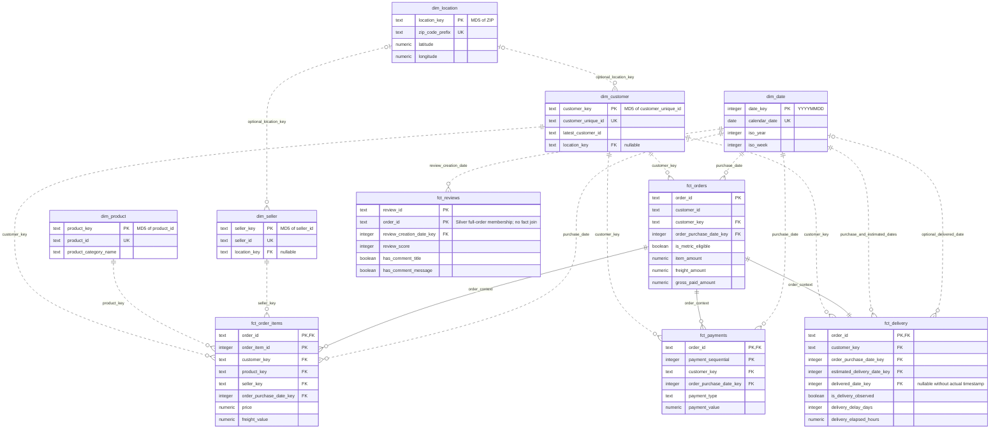

# Architecture and Data Model

Tài liệu mô tả implementation hiện tại; quy trình chạy và phục hồi nằm trong
[runbook](runbooks/01_data_processing_runbook.md), bằng chứng kiểm chứng nằm trong
[acceptance checklist](23_project_acceptance.md). Source of truth là
[source contract](../config/source_contract.json),
[migrations](../infrastructure/postgres/migrations/) và
[dbt models/tests](../dbt/models/schema.yml).

## System Architecture

PostgreSQL và MinIO chạy bằng Compose; Spark/dbt chạy trên host. Airflow có
Python 3.12 environment riêng, standalone SQLite metadata và một BashOperator
mỗi DAG. Metabase dùng local H2 metadata. Synthetic events không đi vào tám core
datasets, pipeline cursors hoặc BI. Không có Kafka/CDC hay distributed Spark cluster.

## Execution Modes and Publication

| Mode | Command | Frozen inputs | Audit tasks | Namespace / completion controls |
| --- | --- | --- | ---: | --- |
| Full | `make dataset` | 8 full streams | 34 | `local_core_v1`; CAS 4 controls sau final gate |
| Incremental | `make dataset-incremental` | 4 deltas + 6 full inputs | 38 | `incremental_core_v1`; inclusive 48h lookback, bootstrap khi chưa có cursor |
| Backfill | `make dataset-backfill BACKFILL_START=<ISO> BACKFILL_END=<ISO>` | 4 bounded streams + 6 full inputs | 38 | `backfill_core_v1`; UTC source-updated-at `[start,end)`, không promote cursors |

Bốn delta tables là customers/orders/order_items/order_payments. Sáu full inputs
là customers/orders dùng làm FK parents và products/sellers/geolocation/order_reviews.
Item v2 pin cả full orders/products/sellers; orders pin full customers;
payments/reviews pin full orders. Delta không phải complete parent key set.

Bronze delivery checkpoint tách khỏi pipeline completion watermark. Mỗi staging
load và deferred resolution commit data/audit atomically theo transaction riêng;
toàn bộ pipeline không rollback chung. Final coordinator giữ staging SHARE locks
qua fresh dbt build/tests rồi commit receipts, run SUCCESS và all-table CAS.
Retry giữ nguyên run ID, bytes, hashes, mode và bounds.

dbt models là live views, không phải atomic published snapshots. BI status gate
ẩn metrics khi latest core run chưa SUCCESS hoặc có audited load mới hơn;
gate không phát hiện writer ngoài audit, cũng không cung cấp snapshot chung cho
mọi dashboard card. Không chạy concurrent staging writers khi kiểm chứng analytics.

## Source ERD

Schema `olist` trong database mặc định `olist_source`; sơ đồ chỉ liệt kê key và
thuộc tính chính. `PK` phản ánh primary key thực tế. `FK` và các cạnh thể hiện
**quan hệ nghiệp vụ dự kiến**, không phải PostgreSQL FK constraints: source cho
phép child-before-parent; Silver kiểm tra membership bằng pinned snapshots.
Cạnh liền là identifying relationship (parent key thuộc child PK); cạnh nét đứt
là non-identifying. Cả hai đều không biểu thị physical FK enforcement.

Mọi source table có `source_updated_at`, `source_sequence`, `source_operation`,
`source_batch_id`, `source_loaded_at`. Money dùng NUMERIC(18,2), currency BRL;
business timestamps nguồn không có offset, được hiểu theo America/Sao_Paulo rồi
Silver chuyển UTC. ZIP là text để giữ leading zeros.

Geolocation giữ từng observation; ZIP không unique nên không join trực tiếp vào
customers/sellers. Translation là bảng phụ được seed từ CSV thứ chín, chưa nằm
trong tám core streams hoặc dbt sources; không có model dịch category hiện tại.
Review key là cả `(review_id, order_id)`, không unique theo từng thành phần riêng.

## Warehouse ERD

Các entities dưới đây là dbt views trong schema `analytics`. `PK`, `UK`, `FK` là
logical keys được kiểm tra bằng dbt tests/reconciliation, không phải constraints
vật lý của views. Sơ đồ chọn key, date role và measure chính; đầy đủ columns nằm
trong [schema.yml](../dbt/models/schema.yml) và generated dbt catalog.

`fct_reviews` không join/test FK tới `fct_orders`: Silver kiểm tra pinned full
orders; bounded warehouse có thể chỉ chứa một phần order history. Review fact
không có customer key hoặc comment text. Không suy ra one-review-per-order.

Shopper/product/seller attributes là current Type 1; customer representative chọn
`source_sequence DESC, customer_id DESC`. Stable MD5 keys là identifiers, không
phải anonymization. Không có dummy unknown members; required parents thiếu phải
qua deferred/reject/integrity gates. Optional location giữ NULL khi ZIP không match.

`dim_location` aggregate trước khi join: exact numeric coordinate medians và joint
city/state mode, ties theo C-collated state/city; representative không phải địa chỉ.
`dim_date` liên tục trên local purchase/estimated/actual/review creation dates,
ISO week đi với ISO year, Monday=1; input rỗng cho dimension rỗng.
Full/empty snapshots không xóa member cũ; backfill không dựng lại Type 1 attributes
hay reviews/geography như tại thời điểm lịch sử.

## Marts and Metric Grains

31 dbt models gồm 8 staging views, 3 intermediates, 5 dimensions, 5 facts và
10 marts. [README lineage](../README.md#dbt-documentation-and-lineage) thể hiện
direct `ref` dependencies; ERD ở trên thể hiện quan hệ dữ liệu.

| Mart | Grain | Input / interpretation |
| --- | --- | --- |
| `mart_revenue_daily` | `order_purchase_date` | Order-grain eligible GMV, freight và observed gross paid |
| `mart_average_order_value` | `order_purchase_date` | Positive-paid eligible orders; toàn kỳ dùng SUM(paid)/SUM(paid orders) |
| `mart_product_daily` | `(order_purchase_date, product_id, product_key)` | Item price/freight theo product, không phân bổ payments |
| `mart_seller_daily` | `(order_purchase_date, seller_id, seller_key)` | Item price/freight theo seller, không phải seller payout |
| `mart_payment_type_daily` | `(order_purchase_date, payment_type)` | Observed payment entries; không nhân installments |
| `mart_delivery_daily` | `order_purchase_date` | Purchase cohorts; valid delivered observations, NULL khi undefined |
| `mart_review_daily` | `review_creation_date` | Review-weighted score/rates; score 1–2 không phải inferred sentiment |
| `mart_customer_value` | `customer_key` | Mọi current shopper, kể cả chưa có order; observed value, không phải predicted LTV |
| `mart_repeat_purchase_daily` | `order_purchase_date` | First/repeat eligible orders theo current staged history |
| `mart_order_status_daily` | `(order_purchase_date, order_status)` | Current status trong purchase cohorts, không phải transition log |

Items/payments aggregate riêng trước khi join orders để tránh fan-out. Distinct
orders/shoppers không additive giữa groups; gộp numerator/denominator trước khi
tính rate/mean toàn kỳ. Delivery durations dùng UTC elapsed hours; lateness dùng
ngày São Paulo. Late earlier orders/status changes có thể phân loại lại repeat history.

BI reader chỉ SELECT sáu models: `fct_orders`, `mart_revenue_daily`,
`mart_average_order_value`, `mart_product_daily`, `mart_seller_daily`,
`mart_payment_type_daily`, cùng `bi_publication_status`. Các entities/marts khác
trong ERD không tự động được cấp quyền Metabase.
